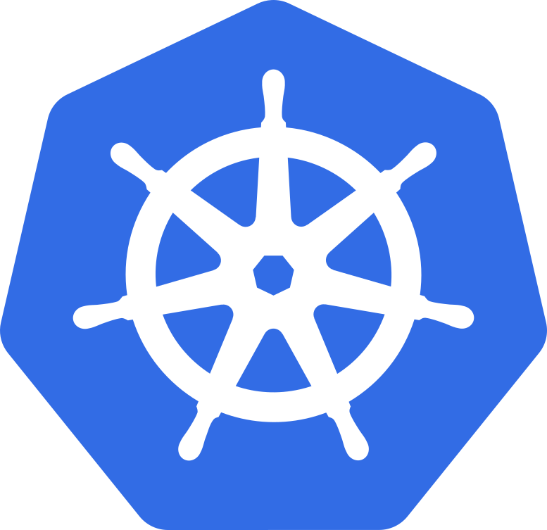

<h1 align="center">
  Infrastructure
</h1>

  
  &nbsp;&nbsp;&nbsp;&nbsp;&nbsp;&nbsp;&nbsp;&nbsp;&nbsp;&nbsp;
  

This repository includes all of the configuration and documentation for my home lab cluster.

This cluster consists of 4 Intel Nucs running [Talos Linux](https://www.talos.dev) with a Synology NAS for large data. More information about this repository and cluster is available at <https://infrastructure.btkostner.io>.

## Features

- [Talos Linux](https://www.talos.dev) cluster with NVMe as a boot drive and SSD for data
- [Argo CD autopilot](https://argocd-autopilot.readthedocs.io/en/stable/) for cluster bootstrapping
- [Cilium](https://cilium.io) as a kube proxy replacement and sidecar-less networking
- [Rook Ceph](https://rook.io) for stateful replicated storage for all nodes
- [Velero](https://velero.io) for offsite cluster backup

## Media services

- [Dispatcharr](https://dispatcharr.github.io/Dispatcharr-Docs/) runs in the `media` namespace at <https://dispatcharr.btkostner.network> through the internal gateway. Its all-in-one container stores application data, PostgreSQL, and recordings on a 10Gi `ceph-safe-block` volume mounted at `/data`. A Gluetun native sidecar routes external traffic and DNS through Mullvad WireGuard, with a firewall kill switch that blocks external traffic when the VPN is unavailable. Dispatcharr starts only after Gluetun is healthy; HTTP ingress on port `9191` and cluster pod/service traffic remain allowed outside the tunnel. The `dispatcharr-vpn` ExternalSecret reads the `private-key` and `addresses` fields from the 1Password `gluetun-credentials` item. Create the first admin account in the web interface, then add M3U and EPG sources. In-cluster clients can use `http://dispatcharr.media.svc.cluster.local`. Argo CD discovers `cluster/media/dispatcharr/kustomization.yaml` after it is pushed to `main`.
